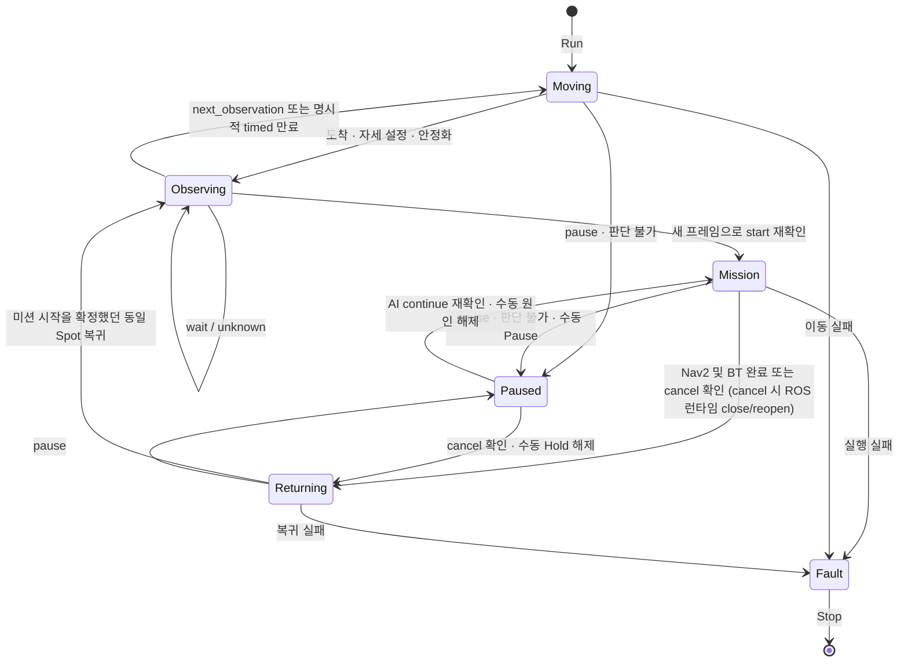

# 관찰·순찰과 연속 미션 감독

Operate는 관찰 위치와 작업 미션을 분리합니다. `ObservationMode`라는 미션 이름을
찾지 않으며, 관찰 지점마다 실행할 작업 미션을 연결합니다. Qwen은 Run부터 Stop까지
메모리에 유지되고, 이동·관찰·작업·일시중지·복귀 중에도 계속 추론합니다.



도식의 Paused는 직전 단계의 진행 상태를 보존합니다. 복귀 중 멈췄다면 복귀를
재개하며, 완료된 waypoint나 BT 액션을 처음부터 다시 실행하지 않습니다.

## 세 가지 판단 작업

| 상태 | Qwen 출력 | 실행기 처리 |
|---|---|---|
| 관찰 모드: 이동·자세 설정·정착 | `continue / pause` | 이동 감독. 미션 ID는 null이고 미션 선택 불가 |
| 관찰 모드: Spot에서 관찰 | `start / wait / next_observation / unknown` | 해당 지점의 후보 미션만 실행 가능 |
| 미션 모드: 주행·BT·일시중지 | `continue / pause / cancel` | 현재 미션만 감독. cancel은 작업 포기 후 원래 관찰 Spot 복귀 |
| 관찰 Spot 복귀·도착 자세 설정 | `continue / pause` | 이동 감독. 끝난 미션 취소나 다른 미션 선택 불가 |

- `start`는 기본적으로 서로 다른 프레임 **4회**에서 같은 미션이 확인돼야 합니다.
  이동 중 결과를 도착 후 확인 횟수에 더하지 않습니다.
- 새 작업 단계의 물리 동작 전에는 유효한 `continue`가 필요합니다.
- 실행 중 `pause` 또는 유효하지 않은 감독 결과는 AI 일시중지 원인이 됩니다.
  서로 다른 최신 프레임 **2회**에서 `continue`가 확인되면 AI 원인만 해제합니다.
- `cancel`은 현재 미션을 포기합니다. 하위 동작의 취소가 확인된 뒤, `cancel()`이 ROS 런타임을 영구적으로 latch시키므로 복귀 주행 전에 런타임을 close한 뒤 새로 open합니다. 이 시점에 남아 있는 'ai' 이외의(즉 수동) Pause 원인은 새 런타임에도 그대로 재적용하여, 모델의 cancel이 운영자의 Hold를 조용히 해제하지 못하게 합니다. 이후 원래 관찰 Spot으로 복귀하고 관찰·Patrol을 재개합니다. 이미 끝낸 물리 동작은 되돌리지 않습니다. 취소 확인 실패 시 새 복귀 주행을 시작하지 않고 오류로 유지합니다.
- 수동 Pause는 별도 원인입니다. Qwen의 `continue`나 `cancel`로 해제할 수 없으며 사용자의
  Resume가 필요합니다. 수동 Resume도 남아 있는 AI 원인을 해제하지 않습니다.
- Qwen은 미션 완료를 선언하지 않습니다. Nav2와 BT의 실제 성공을 기준으로 완료하고,
  미션을 시작한 관찰 Spot으로 돌아가 다시 관찰합니다. 이후 next_observation 판단에 따라
  Patrol 순서의 다음 Spot으로 이동합니다.
- 추론 중 실행 단계나 사용자 지시가 바뀌면 이전 상태에서 시작한 결과는 버립니다.

## Record와 Operate의 공통 계획

Record·Train·Operate는 더 이상 Mission Canvas에 섞여 있는 단계가 아니라, Autonomy Studio의 워크스페이스 선택 화면에서 고르는 별도의 **Autonomy Canvas** 워크스페이스 안의 세 단계(rail)입니다. Qwen LoRA 파인튜닝은 Record의 하위 작업이 아니라 그 사이의 독립된 **Train** 단계로 분리되어 있습니다.

Record → **Data Collection**의 지도 좌측 상단에서 **On Map / At Robot**으로 관찰 지점을 만듭니다. 경로 편집에서 방문 순서·**Closed loop**·지점별 후보 Mission을 저장합니다. Operate의 **Observation plan**은 그대로 유지하며 같은 계획과 체류 시간 등을 편집합니다. 두 화면은 맵의 단일 `autonomy.json`과 안정된 Spot/Mission ID를 공유하고, 저장 후 서로 같은 버전을 읽습니다.

- Record의 **Start Patrol**은 저장된 관찰 경로만 실행합니다. 하위 Mission은 관찰 지점에 도착한 뒤 사용자가 명시적으로 실행합니다.
- Record의 미션 사이클은 작업과 동일 출발 Observation 복귀·자세 안정화까지 포함하며 녹화 여부와 독립적입니다.
- Record의 **Stop**은 주행·BT를 중지하고 맵과 로컬라이제이션은 유지합니다. **Unload map**은 별도 기능입니다. **Stop capture / Save episode**는 로봇 이동을 종료하지 않습니다.
- One-way는 마지막 지점에서 멈춥니다. Closed loop는 마지막→첫 지점을 연결해 반복합니다. **Operate는 One-way의 마지막 지점에서도 관찰·미션 선택을 유지하며 사용자 Stop 전까지 종료하지 않습니다.**
- 관찰 지점 삭제는 좌표 자체를 지우며, 계획에서 제거하는 동작은 경로 참조만 제거합니다. 기존 에피소드를 여는 것으로 주행 경로나 미션을 복원·실행하지 않습니다.

## Operate 사용

1. Record에서 관찰 지점·경로·하위 Mission 연결을 저장합니다. 필요하면 독립적인 Episode Capture로 데이터를 수집하고 학습합니다.
2. Operate에서 **Load Map → Localize** 후 **Observation plan**을 확인합니다. Fixed/Patrol, 방문 순서, Dwell 등 변경한 계획은 저장한 뒤 실행합니다.
3. **Reasoning model**을 선택하고 지도 **Run**을 누릅니다. 후보 미션이 비어 있는 지점은 관찰만 합니다.
4. **Pause / Resume**는 진행 위치를 보존합니다. **Stop**은 자율 작업과 추론을 종료하고 Qwen을 unload합니다.

이전 관찰 자세는 `arrival_bt`로 보존합니다. 새 지점은 현재 카메라 자세를 유지하며,
필요하면 설정 파일에 별도의 도착 자세 BT를 지정합니다.

## 실행 범위와 오류 처리

- 현재 중단·재개를 지원하는 BT 노드는 `Sequence`, `Loop`, `Wait`, `Rotate`,
  `JointControl`, `HomeMeal`, `ArmStateGate`, 감독용 `SendCommand`입니다. 주행은 현재 목표를 보존하고,
  BT는 동일 트리 인스턴스와 실행 커서를 유지합니다.
- 감독용 `SendCommand`는 GR00T/LeRobot의 `LOAD / RESUME / STOP / CLEAR`를
  직접 policy 서비스에 연결합니다. `LOAD`는 액추에이터를 시작하지 않습니다.
  AI 일시중지는 모델을 메모리에 둔 채 출력과 잔여 action chunk를 멈추고,
  재개는 같은 모델에서 새 관측으로 이어갑니다. 완료된 LOAD나 BT를 재생하지 않습니다.
- 이 경로는 policy 런타임의 `confirmed_pose_hold_v2` 응답을 먼저 확인합니다.
  오래된 런타임, 트리 내 backend 교체, Docker 제어용 SendCommand와 지원하지 않는
  사용자 정의 노드는 거부합니다. 일반 Run의 TaskCommand 경로는 유지합니다.
- JointControl·Rotate는 최신 관절/주행 피드백으로 정지를 확인합니다.
  정지·재개 확인 실패, BT 실패 또는 주행 실패는 오류 상태로 유지합니다.
  Stop으로 정리하기 전 새 세션을 시작할 수 없습니다.
- VLA START 응답이 유실되거나 지연되어 상태를 확인할 수 없으면 별도의
  `FAULT_STOP`으로 서버의 START/RESUME/LOAD를 잠급니다. 정지 확인 없이
  Stop 성공을 반환하지 않습니다. 이 오류 잠금은 policy 런타임 재시작과
  모델 재로드 후에만 해제되며 정상 AI pause/continue에는 적용되지 않습니다.
- Stop 이후 늦게 도착한 `continue`나 ROS 목표 응답으로 실행이 재개되지 않습니다.
- 서버가 재시작되면 미완료 세션을 표시하고 Stop을 요구합니다. 자동 재개하지 않습니다.
- 이 감독은 의미적 상황 판단입니다. Nav2/VLA의 저수준 보호와 비상 정지를 대체하지 않습니다.
- 경로는 단일 연결 경로나 폐순회를 지원합니다. 분기·불연결 경로는 실행하지 않습니다.

## 저장과 학습 계약

```text
/workspace/navigation/maps/<map>/spots.json     # 관찰 위치·방향·이름
/workspace/navigation/maps/<map>/autonomy.json # 순회와 후보 미션
/workspace/navigation/missions/<map>/<mission>/mission.json
/workspace/navigation/.autonomy_session.json # 비정상 종료 감지·진행 표식
/workspace/logs/operate/<map>.jsonl            # 판단 제안과 실제 실행 이력
/workspace/dataset/reasoning/<map>/<observation|patrol|mission>/raw_episode_NNNN/
```

`autonomy.json`의 `schema_version: 2`는 다음 필드를 사용합니다.

- `revision`, `mode` (`fixed` / `patrol`), `route_closed` (기존 파일의 기본값은 `true`)
- `settle_seconds`, `interval_seconds`
- `start_confirmations` (기본 3), `resume_confirmations` (기본 2)
- `mission_start_policy: confirm_at_arrival`
- `resume_policy: return_to_trigger_spot`
- `excluded_mission_ids`
- `observations`: `spot_id`, `dwell_seconds`, `mission_ids`, 선택적인 `arrival_bt`

기존 v1의 빈 후보 목록은 “모든 작업 미션”을 뜻했습니다. 읽을 때 현재 작업 ID로
명시적으로 확장하여 동작을 보존하고, 다음 Save에서 v2로 저장합니다.
기존 파일이나 수집 데이터를 시작 시 일괄 수정하지 않습니다.

수집은 주행 시작·종료와 분리합니다. Episode의 Capture type은 실제 Observation/Patrol/Mission 문맥과 일치해야 합니다. 연속 촬영 중 역할·대상이 바뀌면 `/collection/episodes/{id}/segment`가 기존 구간을 닫고 같은 `group_id`의 다음 구간을 만듭니다. `previous_episode_id`와 `next_episode_id`로 연결하고 동일 요청 재시도는 같은 구간을 반환합니다. 녹화하지 않는 동안 실행 변화만으로 데이터를 만들지 않습니다.

촬영하던 Mission의 `/return`은 고정한 출발 Spot 스냅샷으로 Patrol 복귀 구간을 연결합니다. 미션 촬영 없이 복귀 중 녹화를 켜면 일반 Patrol에 프레임의 `returning` 문맥을 남깁니다. 초기 접근은 `approaching`과 `from_spot_id: null`로 표시하며 단일 목적지 Patrol도 허용합니다. 기존 과거 데이터를 이동하거나 재작성하지 않습니다.

수집 폴더의 `episode.json`, `samples.jsonl`, 이미지·마스크 구조는 유지합니다.
프레임에는 `reasoning_task`, 관찰/실행 단계, 현재 미션과 진행 위치, 후보 ID,
컨텍스트 버전과 계획·미션 카탈로그 스냅샷 참조를 함께 저장합니다.
서버의 실행 이력과 이미지 **수신 시각**을 대응시킵니다. 센서 노출 시각을
확정한 것으로 간주하지 않으며, 브라우저 Record 실행 보고는 별도 출처로 표시합니다.

수동 라벨링·Auto Labeling·학습·실시간 추론은 `mission_decisions.py`의 공통 계약을
사용합니다. 과거 `wait`를 `pause`로 자동 변환하지 않습니다. 기존 선택용 모델이
감독도 학습했다고 간주하지 않으며, `continue / pause / cancel` 데이터는 별도로 수집·검토하고
학습해야 합니다. 코드 반영만으로 모델 가중치가 바뀌지는 않습니다.
자세한 형식은 `cyclo_brain/policy/qwen/docs/COLLECTION_DATA_SPEC_KO.md`를 참고합니다.

## 모듈 경계

| 모듈 | 역할 |
|---|---|
| `autonomy.py` | 세션 소유권, 상태, Pause/Resume/Stop, 오류 처리 |
| `autonomy_session.py` | 순찰 → 도착 재확인 → 미션 → 동일 Spot 복귀 |
| `autonomy_mission_cancel.py` | `cancel` 확정 후 액추에이터 ack 확인, ROS 런타임 close/reopen, 수동 Pause 원인 재적용, 복귀 전환 |
| `autonomy_reasoner.py` | 최신 상태의 추론, 감독 판단과 재개 확인 |
| `autonomy_actions.py` | 단일 ROS 동작 작업자와 추론 루프 병행 |
| `autonomy_context.py` | 실행 상태와 이미지 수신 시각의 대응 이력 |
| `autonomy_confirmation.py` | 서로 다른 프레임의 시작·재개 확인 |
| `autonomy_routes.py` | HTTP 라우터와 요청 모델 |
| `autonomy_config.py` | 설정 검증·이전, Spot·미션·BT 스냅샷 |
| `execution_state.py` | 실행 상태의 정규화된 버전 스냅샷 (`schema_version`, `lifecycle`/`activity`/`control`) 생성 |
| `autonomy_runtime*.py` | ROS 연결, 동작, 일시중지·재개·취소 |
| `bt_readiness.py` | Task Engine BT 서비스(`/bt/nodes/catalog` 등)의 ROS 준비 상태 조회용 독립 라우터(`/bt/readiness`). `AutonomyController` 시작/감독 흐름과는 분리되어 있음 |
| `bt/pause_control.py`, `bt/execution_pause.py` | BT 서비스와 트리 커서 보존 |
| `bt/inference_supervisor.py`, `bt/actions/supervised_command.py` | VLA 수명주기와 감독용 SendCommand |
| `policy/common/runtime/main_runtime/confirmed_hold.py` | 관절·주행 피드백에 따른 VLA 정지 확인 |
| `mission_decisions.py` | 선택·감독의 공통 입력·출력 계약 |
| `reasoning_contract.py`, `reasoning_capture_context.py` | 요청과 프레임 문맥 검증 |
| `collection_segments.py`, `collection_returns.py` | 실행과 독립적인 유형 구간 전환·연결·복귀 스냅샷 |
| `collection_training.py`, `reasoning_training_metadata.py` | 학습 행과 출처 집계 |
| `useAutonomyOperation.js` | 서버 상태 표시와 사용자 명령 전달 |

## 기존 관찰 미션 이전

Home의 기존 `ObservationMode`는 수동 실행 호환용으로 남고 Qwen 후보에서 제외됩니다.
다른 지도는 아래 도구를 명시적으로 실행합니다. 기본은 변경 계획만 출력합니다.

```bash
python -m supervisor_api.migrate_observation_plan \
  --root /workspace/navigation --map Home \
  --observation-mission ObservationMode --tasks CleanTable ServeDish
# 결과 확인 후 --apply 추가
```

## 서비스 반영

UI 빌드와 supervisor API뿐 아니라 Task Engine도 새 코드를 읽어야 합니다.
감독 실행기는 새 `/bt/set_paused` 서비스를 확인한 후 BT를 실행합니다.
기존 `/bt/set_running(false)`는 트리를 리셋하므로 Pause 용도로 사용하지 않습니다.
VLA를 사용한다면 공통 policy 런타임과 RobotClient SDK도 갱신하고 해당 backend
프로세스를 재시작해야 합니다. 실행 중인 프로세스는 파일만 교체해도 새 모듈을
다시 읽지 않습니다. 서비스의 직렬화 필드는 유지하고 command 7(기능 조회),
8(오류 정지)을 확장했습니다.
진행 중인 실행이 있다면 먼저 Stop한 뒤 서비스를 갱신합니다.

s6 시작 스크립트도 바꾸는 경우 `/etc`와 `/run/service`의 실행 스크립트를 함께
갱신해야 합니다. 이번 모듈 변경만 반영할 때는 시작 스크립트 복사 없이 해당
서비스를 재시작하면 됩니다. 실제 supervisor 프로세스가 ROS workspace overlay와
`interfaces`를 읽는 환경인지 확인합니다.


### 판단 기반 다음 관찰 지점 이동

`departure_policy=reasoning`이 기본이다. `wait`/`unknown`은 현재 지점을 유지하고 `next_observation`은 다음 지점으로 이동한다. `action_allowed`, 프레임 stamp, context_version, pause/Stop 상태를 확인하고 실행한다. 기존 시간 순회는 지점별 `departure_policy=timed`일 때만 사용한다. Record에서는 동일 설정으로 타이머 없이 머무르며 다음 지점 버튼으로 직접 출발을 시연한다.

### 내비게이션 시간과 도착 검증

- Nav2/단독 localization 시작 시 `/robot_state_publisher`의 `use_sim_time`을 확인합니다. 시뮬레이션은 `/clock` 수신도 필요합니다. 검색 실패를 실로봇 모드로 간주하지 않으며, 명시한 시간 설정이 로봇과 충돌하면 시작을 거부합니다.
- Record/Operate의 서버 내비게이션은 Nav2 성공 후 최신 `map → base_link` TF로 도착을 재확인합니다. 위치 오차 0.25m, 방향 오차 0.15rad 이내여야 합니다(현재 Nav2 목표 허용치 0.2m/0.1rad에 측정 여유 적용). TF 시간 오차는 ±1.5초 이내여야 하며 AMCL의 미래 시각 보정을 허용합니다.
- 3초 동안 검증되지 않으면 관찰/작업 BT로 넘어가지 않고 도착 검증 오류로 종료합니다. 위치 허용치는 물리 작업의 개별 접근 조건을 대체하지 않습니다.
- `/robot_state_publisher`, `/bt_navigator`, `map`, `base_link` 이름은 현재 로봇 구성 기준입니다. 네임스페이스/프레임 이름 변경 시 검증 모듈도 함께 설정해야 합니다.


### Operate 대화와 순회 방향

- 지도 우측 하단의 말풍선으로 Qwen과 대화합니다. 최근 대화, 실행 상태, 마지막 장면 판단을 전달하며 대화 요청 자체는 새 카메라 판독을 하지 않습니다.
- 대화는 같은 모델의 기본 언어 능력을 사용하며 요청 동안만 미션 LoRA를 비활성화합니다. 종료·오류 후에는 원래 어댑터가 복원됩니다. 추가 모델을 VRAM에 올리지 않습니다.
- 지원 명령: 순회 역방향/정방향, 일시정지, 재개, 종료. 명확한 단축 명령은 즉시 처리하고, 그 외 명령은 Qwen이 분류합니다. 질문/설명은 자연어 답변으로 분리합니다. 컨트롤러가 상태를 검증해 실행 결과를 응답합니다. 작업 지령은 현재 `operator_instruction`에 넣어 다음 카메라 기반 판단부터 전달합니다. 메시지만으로 임의 미션을 직접 시작하지 않으며 기존 미션 후보/확인 절차를 유지합니다. `지령 해제`로 이전 지령을 지울 수 있습니다. 저장된 미션 규칙은 변경하지 않습니다.
- 역방향은 관찰 지점 방문 순서를 뒤집습니다. 주행 중에는 기존 Nav2 목표 취소를 확인한 뒤 마지막 관찰 지점으로 돌아갑니다. 첫 지점에 도착하기 전이면 그 지점으로 이동한 뒤 역순을 적용합니다. 하위 미션 중 변경은 해당 미션 복귀 후 적용합니다. 저장된 route는 변경하지 않습니다.
- 대화 추론 중 장면 추론은 동일 모델 사용을 위해 잠시 대기합니다. 중복 request_id는 재실행하지 않으며, 추론 중 세션/실행 문맥이 바뀌면 명령을 거부합니다. 수동 재개는 AI가 건 일시정지를 해제하지 않습니다.
- API: GET/POST `/autonomy/conversation`. POST 본문은 `text`, `request_id`; 응답은 `messages`, `pending`, `error`입니다.

- `사람있다. 멈춰봐!`, `Stop right there.`, `Hold it for a second.`는 수동 일시정지로 즉시 처리합니다. `계속 가`/`resume`으로 수동 정지를 해제합니다. 별도 대화 모델은 사용하지 않으며 현재 Qwen의 기본 언어 기능을 명령 분류에 사용하고, 실제 장면 판단은 선택된 미션 LoRA로 계속 수행합니다.
