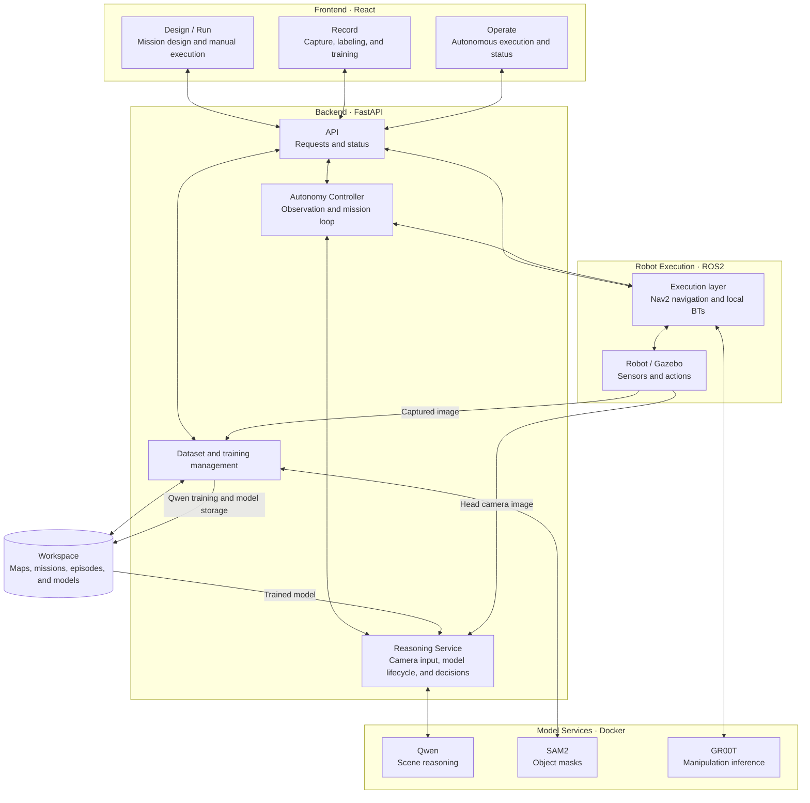

# Phase 1 Architecture Overview

> UI modules have since been separated by Canvas. See [Shared map workspace](../orchestrator/ui/src/features/mapWorkspace/README.md) for current ownership and runtime composition.

## Frontend

- **React UI** (`orchestrator/ui/src/features/missionCanvas/`): Displays maps and robot status, and controls operations through backend APIs and ROS communication.
- **Design / Run**: Builds missions from waypoints, routes, and local behavior trees (BTs), and runs them manually.
- **Record**: Provides image capture, episode management, mask and mission labeling, and model training.
- **Operate**: Provides observation plans, model selection, autonomous execution, Qwen decisions, activity logs, and BT execution status.

## Backend

- **FastAPI** (`docker/supervisor_api/`): Exposes APIs for maps, missions, datasets, training, and model execution.
- **Autonomy Controller** (`autonomy.py`): Coordinates observation point navigation, Qwen decisions, mission execution, and return to observation or patrol.
- **ROS2 execution layer** (`autonomy_runtime.py`, `orchestrator/orchestrator/bt/`): Executes Nav2 navigation and local BTs at each waypoint.
- **Model modules** (`cyclo_brain/policy/`): Docker services provide Qwen reasoning, SAM2 mask generation, and GR00T manipulation inference.

## System Block Diagram

Arrows show the main request and data flows. Details such as UI subscriptions to ROS status are omitted.

## Execution and Storage

`UI → FastAPI → Autonomy control → Qwen / ROS2·Nav2·BT → UI status updates`

In Phase 1, Qwen makes decisions at observation points. During mission execution, inference pauses while the model stays loaded in memory. Observation resumes after the mission completes; Stop ends autonomous execution and shuts down Qwen.

- **Maps and missions**: `docker/workspace/navigation/`
- **Collected data**: `docker/workspace/dataset/reasoning/<map>/raw_episode_####/`
- **Trained reasoning models**: `docker/workspace/model/qwen/reasoning/<map>/<model_name>/`
