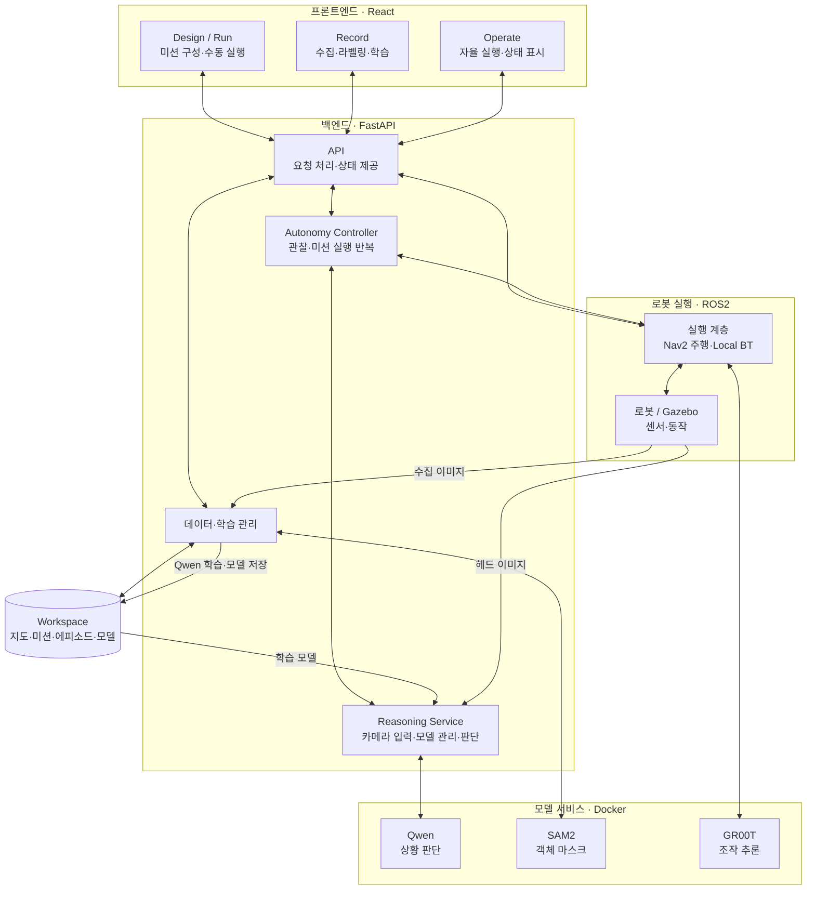

# 1차 개발 구조 요약

> UI 모듈 구조는 이후 Canvas별로 분리되었습니다. 현재 소유권과 공통 런타임 구조는 [Shared map workspace](../orchestrator/ui/src/features/mapWorkspace/README.md)를 참고하세요.

## 프론트엔드
- **React UI** (`orchestrator/ui/src/features/missionCanvas/`): 지도와 로봇 상태를 표시하고 백엔드 API·ROS 통신으로 동작을 제어합니다.
- **Design / Run**: waypoint·경로·local BT로 미션을 구성하고 수동 실행합니다.
- **Record**: 이미지 수집, 에피소드 관리, 마스크·미션 라벨링 및 모델 학습을 제공합니다.
- **Operate**: 관찰 계획·모델 선택, 자율 실행, Qwen 판단·Activity·BT 진행 상태를 표시합니다.

## 백엔드
- **FastAPI** (`docker/supervisor_api/`): 지도·미션·데이터·학습·모델 실행 API를 제공합니다.
- **Autonomy Controller** (`autonomy.py`): 관찰 지점 이동 → Qwen 판단 → 미션 실행 → 관찰 복귀·순회를 관리합니다.
- **ROS2 실행 계층** (`autonomy_runtime.py`, `orchestrator/orchestrator/bt/`): Nav2 주행과 waypoint별 local BT를 실행합니다.
- **모델 모듈** (`cyclo_brain/policy/`): Qwen은 상황 판단, SAM2는 마스크 생성, GR00T는 조작 추론을 담당하며 Docker로 구동합니다.

## 시스템 블록 다이어그램

화살표는 주요 요청·데이터 흐름을 나타냅니다. UI의 ROS 상태 구독 등 세부 통신은 생략했습니다.

## 실행·저장 흐름
`UI → FastAPI → 자율 실행 제어 → Qwen / ROS2·Nav2·BT → 상태를 UI에 반영`

현재 관찰 지점에서 Qwen이 판단하고, 미션 실행 중에는 모델을 메모리에 유지한 채 추론을 대기합니다. 미션 완료 후 관찰을 반복하며, Stop하면 자율 실행과 Qwen을 종료합니다.

- **지도·미션**: `docker/workspace/navigation/`
- **수집 데이터**: `docker/workspace/dataset/reasoning/<map>/raw_episode_####/`
- **학습된 추론 모델**: `docker/workspace/model/qwen/reasoning/<map>/<model_name>/`
